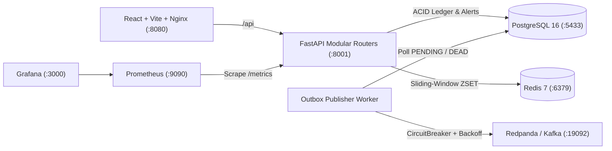
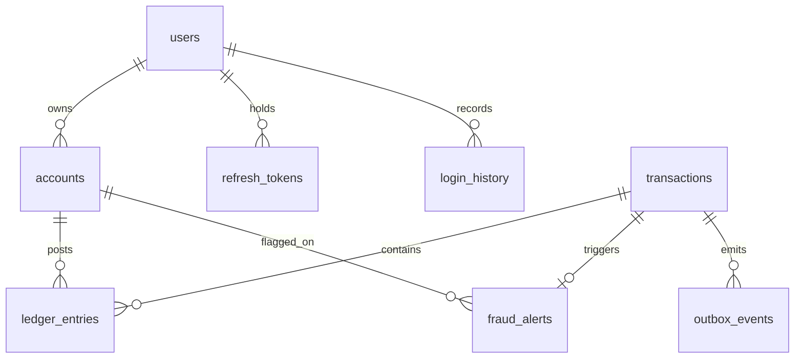

# FinGuard

Double-entry fintech ledger, multi-currency FX transfers, JWT/TOTP authentication, and hybrid rule + ML fraud detection platform built with FastAPI, PostgreSQL, Redis, Redpanda, React, Prometheus, and Grafana.

## Feature Status

| Capability | Status | Notes |
| --- | --- | --- |
| Double-entry ledger & DB triggers (I1-I9) | Implemented | Append-only `ledger_entries`, balanced transactions, no customer overdrafts, `reconcile_ledger.py` in CI |
| Multi-currency FX & atomic refunds | Implemented | `TND`, `USD`, `EUR` via `SYSTEM_FX` clearing accounts, duplicate-refund protection |
| Scoped idempotency & deadlock-mitigated locking (40P01/40001 retry) | Implemented | `(user_id, endpoint, key)` + payload hash check, sorted UUID `FOR UPDATE` |
| Private access, RBAC, MFA & sessions | Implemented | Mandatory login, `CUSTOMER`/`ADMIN`/`FRAUD_ANALYST`/`AUDITOR`, encrypted TOTP secrets, refresh rotation |
| Sliding-window Redis rate limiting & CircuitBreaker | Implemented | Redis `ZSET` sliding window wrapped in `CircuitBreaker` + jittered `retry_with_backoff`, in-memory fallback |
| Structured JSON logging & `X-Request-ID` | Implemented | `JsonFormatter` with `request_id` context propagation on every HTTP request |
| Prometheus metrics & Grafana dashboard | Implemented | `prometheus_client` histograms/counters + `monitoring/grafana/dashboards/finguard-overview.json` |
| Automated `FraudAlert` & state machine | Implemented | `POST /transfers` computes server-side features, creates `PENDING` alerts, enforces `INVESTIGATING` -> `APPROVED`/`BLOCKED` |
| Outbox publisher worker & `DEAD` state | Implemented | `outbox_events` tracks `PENDING`/`PUBLISHED`/`DEAD` with max-attempts backoff in `outbox-publisher` service |
| ML fraud model (`GradientBoostingClassifier`) | Partial | Rules-only fallback works when `.joblib` is unavailable; model trained on synthetic data (`docs/ml-evaluation.md`) |
| Dependency & container security scans | Implemented | `pip-audit`, `npm audit`, `Gitleaks`, and `Trivy` run as blocking checks in CI |
| Cloud production deployment & live bank rails | Planned | Local Docker Compose stack is ready; cloud IaC and external PSP rails are planned |

## Architecture

## Database ER Diagram

## Quickstart

- `make up` - Start full Docker Compose stack (Postgres, Redis, Redpanda, Backend, Outbox Worker, Frontend, Prometheus, Grafana)
- `make test-db` - Recreate local `finguard_test` DB and apply Alembic migrations
- `make lint` - Run `ruff`, `mypy`, `eslint`, and `tsc`
- `make test` - Run `pytest` and `vitest`

## Screenshots

- Place UI and Grafana screenshots in `docs/screenshots/` (e.g., `login.png`, `dashboard.png`, `fraud-alerts.png`, `grafana.png`).
